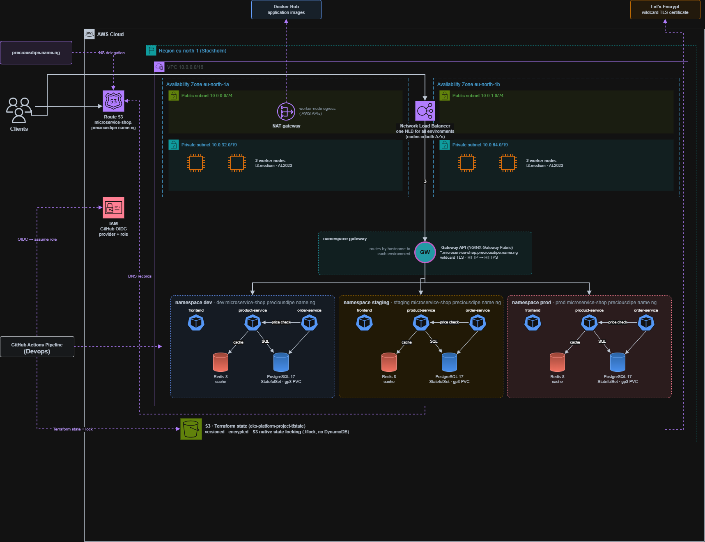

# EKS Microservice Platform

A production-style Kubernetes platform on **Amazon EKS** (eu-north-1), built with **Terraform** and deployed with **Helm** and **GitHub Actions**. One cluster hosts three environments, **dev**, **staging** and **prod**, each in its own namespace and each running the *microservice-shop* application (frontend, product-service, order-service, PostgreSQL, Redis).

| Environment | URL |
|---|---|
| dev | https://dev.microservice-shop.preciousdipe.name.ng |
| staging | https://staging.microservice-shop.preciousdipe.name.ng |
| prod | https://prod.microservice-shop.preciousdipe.name.ng |

## Architecture



**Request flow:**
1. A client resolves `dev.microservice-shop.preciousdipe.name.ng` through Route 53.
2. The client connects over HTTPS to a **Network Load Balancer**, which spans both Availability Zones.
3. The NLB forwards the request to the **Gateway API** in the `gateway` namespace, which matches the hostname to the `dev` namespace's routes.
4. The routes the request to the frontend, `/api/products` to product-service and `/api/orders` to order-service.
5. The services use each namespace's database PostgreSQL and Redis.

---

## Step-by-step deployment

Run everything from **WSL / Linux** in the repo, as an AWS identity with admin rights in account `143977713038`.

### 0. Setup Region
```bash
cd infrastructure
export AWS_REGION=eu-north-1
```

### 1. Setup S3 bucket 

```bash
terraform init && terraform apply          # 
```

### 2. Setup Pipeline role

Creates the GitHub OIDC provider and the IAM role that GitHub Actions assumes. 
```bash
bash script/tf-init.sh shared github-oidc
terraform -chdir=environment/shared/github-oidc plan -out=tfplan
terraform -chdir=environment/shared/github-oidc apply tfplan
terraform -chdir=environment/shared/github-oidc output role_arn      
```

### 3. Setup Networking and DNS zone

```bash
bash script/tf-init.sh shared networking
terraform -chdir=environment/shared/networking plan -out=tfplan
terraform -chdir=environment/shared/networking apply tfplan
terraform -chdir=environment/shared/networking output dns_name_servers
```

### 4. Set the EKS cluster
```bash
bash script/tf-init.sh shared eks
terraform -chdir=environment/shared/eks plan -out=tfplan
terraform -chdir=environment/shared/eks apply tfplan

aws eks update-kubeconfig --region eu-north-1 --name eks-microservice-platform
kubectl get nodes                                  
```

### 5. Setup Add-ons on EKS

```bash
export TF_VAR_acme_email='<your-email>'            
bash script/tf-init.sh shared platform
terraform -chdir=environment/shared/platform plan -out=tfplan
terraform -chdir=environment/shared/platform apply tfplan

kubectl get gatewayclass nginx                     
kubectl get clusterissuer letsencrypt              
kubectl -n gateway get gateway,certificate         
```

### 6. Install the Application via Helm
Repeat for `dev`, `staging` and `prod`, using a different user and password for each:

```bash
cd ..
ENV=dev
helm upgrade --install microservice-shop ./application --namespace $ENV \
  -f application/values-$ENV.yaml \
  --set images.registry=docker.io/preciousdipe \
  --set images.productService.tag=v1.0.0 --set images.orderService.tag=v1.0.0 \
  --set images.frontend=busybox:1.37.0 \
  --set images.postgres=postgres:17.11-alpine3.24 \
  --set images.redis=redis:8.8.3-alpine \
  --set secrets.postgresUser='<db-user>' \
  --set secrets.postgresPassword='<db-password>' \
  --set secrets.redisPassword='<redis-password>'     

kubectl -n $ENV get pods,httproute
```

#### How the pipeline works

There is **one EKS cluster** with **three namespaces**, `dev`, `staging` and `prod`, and the pipeline keeps the application and the cluster separate.

**Application (Helm Deploy): deployed per branch, to one namespace only.** Each long-lived branch maps to one namespace: `develop` to `dev`, `staging` to `staging`, and `production` to `prod`. When you push a change under `application/` to one of those branches, the **Helm Deploy** workflow updates **only that branch's namespace**, and the other two environments are not touched. It signs in to AWS through GitHub OIDC using the GitHub environment linked to the branch (`develop`, `staging` or `production`), builds the image registry, image tags and passwords from that environment's secrets and variables, and runs `helm upgrade` with that environment's `values-<env>.yaml`. If the new release doesn't become healthy within 10 minutes, Helm rolls it back automatically. Pull requests that change `application/` only lint the chart; they don't deploy anything. To redeploy an environment, or ship new image tags without a code change, run **Actions → Helm Deploy → Run workflow** and pick the environment.

A typical change goes like this: push it to `develop` and check it in `dev`, then merge `develop` into `staging` and check it there, then merge `staging` into `production` to release it to `prod`.

**Cluster (Deploy Infrastructure): changes rarely, and only from `production`.** The VPC, the EKS cluster and the shared add-ons (Gateway, cert-manager, external-dns, metrics-server and the namespaces themselves) are built once and shared by all three environments. You don't need this workflow to deploy the application. It only runs when files under `infrastructure/` change: a pull request with such a change gets a `terraform plan` posted as a comment, and pushing or merging it into `production` runs `terraform apply` for networking, eks and platform, in that order. Only one branch applies because there is a single Terraform state, kept in S3 with native locking. If two branches both applied, they would keep overwriting each other's changes to the same cluster.

**Tests (Platform Tests).** After every successful deploy to `dev`, the **Platform Tests** workflow runs automatically against `dev`. It checks zero-downtime rollouts, self-healing, autoscaling and data persistence. You can also run it by hand against `staging`. It never runs against `prod`, because the tests delete pods and generate load.

#### Differences between the environments

All three environments run the same chart in their own namespace on the same cluster, behind the same shared Gateway. The differences come from `application/values-<env>.yaml` and the namespace quotas in `script/shared/platform-tfvars.sh`.

| | dev | staging | prod |
|---|---|---|---|
| Git branch | `develop` | `staging` | `production` |
| Namespace / GitHub environment | `dev` / `develop` | `staging` / `staging` | `prod` / `production` |
| URL | `dev.microservice-shop.preciousdipe.name.ng` | `staging.microservice-shop.preciousdipe.name.ng` | `prod.microservice-shop.preciousdipe.name.ng` |
| App deployed by | push of an `application/` change to `develop` | push of an `application/` change to `staging` | push of an `application/` change to `production` |
| frontend replicas (HPA) | 2–4 | 2–4 | 2–6 |
| product / order-service replicas (HPA) | 2–4 each, scale at 50% CPU | 2–4 each, scale at 50% CPU | 2–10 each, scale at 60% CPU |
| product / order-service resources | 100m CPU / 128Mi request, 500m / 256Mi limit | same as dev | 200m CPU / 192Mi request, 1 CPU / 384Mi limit |
| PostgreSQL | 512Mi volume, 250m CPU / 256Mi request | 2Gi volume, same CPU / memory as dev | 10Gi volume, 500m CPU / 512Mi request, 2 CPU / 1Gi limit |
| Pod disruption budget | at least 1 pod per service | at least 1 pod per service | at least 2 pods per service |
| Namespace quota (requests / limits) | 2 CPU · 4Gi / 8 CPU · 8Gi, 30 pods | 2 CPU · 4Gi / 8 CPU · 8Gi, 30 pods | 4 CPU · 8Gi / 16 CPU · 16Gi, 60 pods |
| Default container size (no requests set) | 100m / 128Mi request, 500m / 512Mi limit | same as dev | 200m / 256Mi request, 1 CPU / 1Gi limit |
| Platform tests | automatically after each deploy | on demand | never |

---

## Design decisions

| Decision | Why |
|---|---|
| **One EKS cluster, one namespace per environment** | A control plane, NAT gateway and node group cost the same whether they serve one environment or three. Namespaces keep the environments apart: each has a ResourceQuota, a LimitRange, Pod Security labels and NetworkPolicies, so dev can't reach prod's pods or starve its CPU. |
| **Terraform in layers** (github-oidc → networking → eks → platform) | Each layer has its own state file in S3 and reads the layer below through remote state. A change to the platform add-ons can't touch the VPC, and plans stay small and readable. State uses S3 native locking, so no DynamoDB table is needed. |
| **Private nodes, public load balancers** | Worker nodes have no public IPs and reach the internet only through the NAT gateway (image pulls, AWS APIs). Only the load balancer in the public subnets faces the internet. The VPC spans 2 Availability Zones, with a public and a private subnet in each, and 2 worker nodes per zone, so losing one zone leaves the cluster running. |
| **One shared Gateway and load balancer for all environments** | A single NLB and Gateway (NGINX Gateway Fabric, Gateway API) in the `gateway` namespace serve every environment by hostname, with one wildcard certificate (`*.microservice-shop.preciousdipe.name.ng`). That saves two NLBs (about $35–40/month). Each environment still owns its own routes: an HTTPRoute in its namespace that only it can change. The Gateway only accepts routes from namespaces labelled as environments. Because the shared entry point is managed by Terraform (planned on every PR), not by app releases, an app deploy can't break another environment's traffic. |
| **Let's Encrypt via DNS-01 + external-dns** | The subdomain `microservice-shop.preciousdipe.name.ng` is delegated to this account, so records are managed here without touching the parent domain. cert-manager proves ownership through Route 53 and renews certificates automatically; external-dns creates each environment's DNS record. |
| **PostgreSQL and Redis inside the cluster** | Each environment gets its own database and cache with no extra AWS services or cost. PostgreSQL is a StatefulSet on an encrypted gp3 EBS volume, so data survives pod restarts (verified by the data-persistence test). Redis is a cache only (cache-aside, 60 s TTL), so it needs no volume. |
| **HPA + PDB + pod anti-affinity + rolling updates** | The HPAs (fed by metrics-server) scale the services with CPU load. PodDisruptionBudgets and `maxUnavailable: 0` keep capacity during node maintenance and deployments. Anti-affinity spreads replicas across nodes. |
| **No long-lived credentials** | GitHub Actions signs in with OIDC to a role that only this repository's `develop` / `staging` / `production` environments can assume. Add-ons (load balancer controller, EBS CSI, external-dns, cert-manager) get AWS access through EKS Pod Identity. Images, database users and passwords come from pipeline variables and secrets, never from the repo. |
| **Plan on pull request, apply on merge** | Every infrastructure change is reviewed as a plan in the PR before it reaches AWS. The shared cluster only changes from `production`, because it hosts every environment. |
| **4 × t3.medium** | The VPC CNI gives each pod a VPC IP, which caps a t3.medium at 17 pods. Three environments (about 9 pods each at minimum scale) plus the platform add-ons need about 46 pods; 4 nodes give 68. |

---

## Tests

The `tests/` folder proves the platform's behaviour on a live environment. Each script writes its log to `results/` and ends with `RESULT: PASS` or `RESULT: FAIL`.

| Test | What it proves |
|---|---|
| `zero-downtime.sh` | A rolling update of product-service under 50 req/s of k6 load produces **no 5xx or failed requests**. |
| `self-healing.sh` | Deleted frontend and product-service pods are replaced automatically, and the app keeps answering. |
| `autoscaling.sh` | k6 ramps to 200 req/s, and the **HPA scales product-service** out (and back in). |
| `data-persistence.sh` | An order survives deleting the PostgreSQL pod: new pod, **same PVC, same data**. |

**From the pipeline:** **Actions → Platform Tests → Run workflow**, then pick `dev` or `staging` and a test, or `all`. It also runs automatically against dev after every successful dev deploy. Results appear in the run summary and as a downloadable artifact. Prod is excluded on purpose, because the tests delete pods and generate load.

**From the CLI** (needs kubectl access and Docker for k6):

```bash
NS=dev bash tests/self-healing.sh
NS=staging bash tests/zero-downtime.sh
```

---

## Cleanup

Delete in reverse order. Remove the apps first so their DNS records are cleaned up. The platform destroy removes the shared Gateway and its load balancer while the controllers are still running.

```bash
# 1. Applications (DNS records go with them), then the PostgreSQL volumes
for ns in dev staging prod; do
  helm uninstall microservice-shop -n $ns
  kubectl -n $ns delete pvc -l app.kubernetes.io/name=postgres
done

# 2. Infrastructure
cd infrastructure
terraform -chdir=environment/shared/platform destroy
terraform -chdir=environment/shared/eks destroy
terraform -chdir=environment/shared/networking destroy
terraform -chdir=environment/shared/github-oidc destroy

# 3. Check nothing billable is left
aws eks list-clusters --region eu-north-1
aws elbv2 describe-load-balancers --region eu-north-1 --query 'LoadBalancers[].LoadBalancerName'
aws ec2 describe-nat-gateways --region eu-north-1 --filter Name=state,Values=available --query 'NatGateways[].NatGatewayId'
```

- **Parent domain:** remove the `microservice-shop` NS record in the account that owns `preciousdipe.name.ng`.
- **State bucket:** it has `prevent_destroy`. To delete it too, empty all object versions, then run `aws s3api delete-bucket --bucket eks-platform-project-tfstate`.
- **KMS key:** the cluster's key stays in "pending deletion" for 7 days. This is expected.
