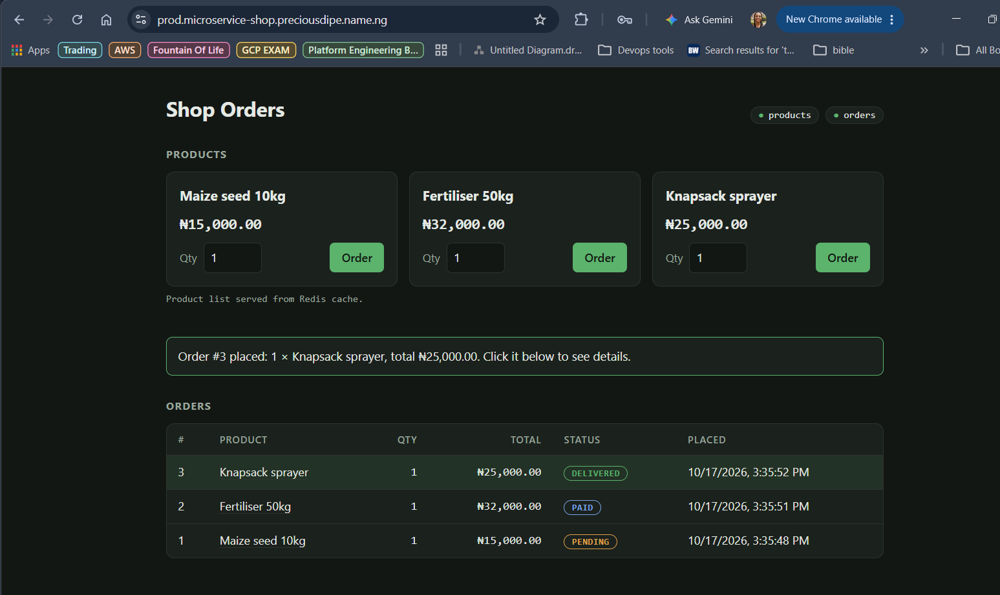
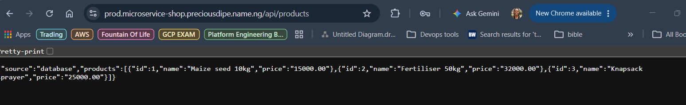
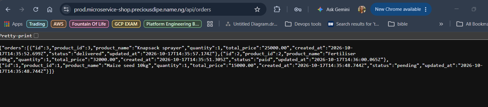

# EKS Microservice Platform

An Application hosted on **Amazon EKS** (eu-north-1), built with **Terraform** and deployed with **Helm** and **GitHub Actions**. The cluster hosts three environments, **dev**, **staging** and **prod**, each in its own namespace running a three tier *microservice-shop* application.

| Environment | URL |
|---|---|
| dev | https://dev.microservice-shop.preciousdipe.name.ng |
| staging | https://staging.microservice-shop.preciousdipe.name.ng |
| prod | https://prod.microservice-shop.preciousdipe.name.ng |

## Architecture


**Request flow:**
A client send request to the url `dev.microservice-shop.preciousdipe.name.ng` through Route 53. The request is sent over HTTPS to a **Network Load Balancer**, The NLB forwards the request to the **Gateway API** in the `gateway` namespace, which matches the hostname to the `dev` namespace's routes, which routes the request to the frontend, to product-service `/api/products` and to order-service `/api/orders`. The services use each namespace's database PostgreSQL and Redis.

### Live environment

The shop running in the `prod` namespace at https://prod.microservice-shop.preciousdipe.name.ng, served through the Gateway with a Let's Encrypt certificate:

https://github.com/user-attachments/assets/38a7fa57-df91-4f9e-b9e0-30c155fb8c0c

**Frontend:** https://prod.microservice-shop.preciousdipe.name.ng



**Product service:** https://prod.microservice-shop.preciousdipe.name.ng/api/products



**Order service:** https://prod.microservice-shop.preciousdipe.name.ng/api/orders



---

## Step-by-step deployment
### Setup Region
```bash
cd infrastructure
export AWS_REGION=eu-north-1
```

### Setup S3 bucket 

```bash
terraform init && terraform apply          # 
```

### Setup Pipeline role

Creates the GitHub OIDC provider and the IAM role that GitHub Actions assumes. 
```bash
bash script/tf-init.sh shared github-oidc
terraform -chdir=environment/shared/github-oidc plan -out=tfplan
terraform -chdir=environment/shared/github-oidc apply tfplan
terraform -chdir=environment/shared/github-oidc output role_arn      
```

### Setup Networking and DNS zone

```bash
bash script/tf-init.sh shared networking
terraform -chdir=environment/shared/networking plan -out=tfplan
terraform -chdir=environment/shared/networking apply tfplan
terraform -chdir=environment/shared/networking output dns_name_servers
```

### Set the EKS cluster
```bash
bash script/tf-init.sh shared eks
terraform -chdir=environment/shared/eks plan -out=tfplan
terraform -chdir=environment/shared/eks apply tfplan

aws eks update-kubeconfig --region eu-north-1 --name eks-microservice-platform
kubectl get nodes                                  
```

### Setup Add-ons on EKS

```bash
export TF_VAR_acme_email='<your-email>'            
bash script/tf-init.sh shared platform
terraform -chdir=environment/shared/platform plan -out=tfplan
terraform -chdir=environment/shared/platform apply tfplan

kubectl get gatewayclass nginx                     
kubectl get clusterissuer letsencrypt              
kubectl -n gateway get gateway,certificate         
```

### Install the Application via Helm
Repeat for `dev`, `staging` and `prod`, using a different user and password for each:

```bash
cd ..
ENV=dev
helm upgrade --install microservice-shop ./application --namespace $ENV \
  -f application/values-$ENV.yaml \
  --set images.registry=docker.io/preciousdipe \
  --set images.productService.tag=v1.0.0 --set images.orderService.tag=v1.0.0 \
  --set images.frontend=busybox:1.37.0 \
  --set images.postgres=postgres:17.11-alpine3.24 \
  --set images.redis=redis:8.8.3-alpine \
  --set secrets.postgresUser='<db-user>' \
  --set secrets.postgresPassword='<db-password>' \
  --set secrets.redisPassword='<redis-password>'     

kubectl -n $ENV get pods,httproute
```

#### How the pipeline works

There is **one EKS cluster** with **three namespaces**, `dev`, `staging` and `prod`, and the pipeline keeps the application and the cluster separate.

**Application (Helm Deploy): deployed per branch, to one namespace only.** Each long-lived branch maps to one namespace: `develop` to `dev`, `staging` to `staging`, and `production` to `prod`. When you push a change under `application/` to one of those branches, the **Helm Deploy** workflow updates **only that branch's namespace**, and the other two environments are not touched. It signs in to AWS through GitHub OIDC using the GitHub environment linked to the branch (`develop`, `staging` or `production`), builds the image registry, image tags and passwords from that environment's secrets and variables, and runs `helm upgrade` with that environment's `values-<env>.yaml`. If the new release doesn't become healthy within 10 minutes, Helm rolls it back automatically. Pull requests that change `application/` only lint the chart; they don't deploy anything. To redeploy an environment, or ship new image tags without a code change, run **Actions → Helm Deploy → Run workflow** and pick the environment.

**Cluster (Deploy Infrastructure): changes rarely, and only from `production`.** The VPC, the EKS cluster and the shared add-ons (Gateway, cert-manager, external-dns, metrics-server and the namespaces themselves) are built once and shared by all three environments. It runs when files under `infrastructure/` change: a pull request with such a change gets a `terraform plan` posted as a comment, and pushing or merging it into `production` runs `terraform apply` for networking, eks and platform, in that order.

**Tests** After every successful deploy to `dev`, the **Platform Tests** workflow runs automatically against `dev`. It checks zero-downtime rollouts, self-healing, autoscaling and data persistence. You can also run it manually against `staging`.

#### Differences between the environments

All three environments run their chart in their own namespace on the same cluster, behind a Gateway API.

| | dev | staging | prod |
|---|---|---|---|
| Git branch | `develop` | `staging` | `production` |
| Namespace / GitHub environment | `dev` / `develop` | `staging` / `staging` | `prod` / `production` |
| URL | `dev.microservice-shop.preciousdipe.name.ng` | `staging.microservice-shop.preciousdipe.name.ng` | `prod.microservice-shop.preciousdipe.name.ng` |
| App deployed by | push of an `application/` change to `develop` | push of an `application/` change to `staging` | push of an `application/` change to `production` |
| frontend replicas (HPA) | 2–4 | 2–4 | 2–6 |
| product / order-service replicas (HPA) | 2–4 each, scale at 50% CPU | 2–4 each, scale at 50% CPU | 2–10 each, scale at 60% CPU |
| product / order-service resources | 100m CPU / 128Mi request, 500m / 256Mi limit | same as dev | 200m CPU / 192Mi request, 1 CPU / 384Mi limit |
| PostgreSQL | 512Mi volume, 250m CPU / 256Mi request | 2Gi volume, same CPU / memory as dev | 10Gi volume, 500m CPU / 512Mi request, 2 CPU / 1Gi limit |
| Pod disruption budget | at least 1 pod per service | at least 1 pod per service | at least 2 pods per service |
| Namespace quota (requests / limits) | 2 CPU · 4Gi / 8 CPU · 8Gi, 30 pods | 2 CPU · 4Gi / 8 CPU · 8Gi, 30 pods | 4 CPU · 8Gi / 16 CPU · 16Gi, 60 pods |
| Default container size (no requests set) | 100m / 128Mi request, 500m / 512Mi limit | same as dev | 200m / 256Mi request, 1 CPU / 1Gi limit |
| Platform tests | automatically after each deploy | on demand | never |

---

## Design decisions

1. **One cluster for all environments.** I set up this project in one EKS cluster because running three separate clusters, one per environment, would triple the cost, and I'm trying to keep the project cost-effective. Running all the environments in one cluster, separated by namespaces (`dev`, `staging` and `prod`), is much cheaper. To keep the environments from affecting each other, I gave each namespace its own resource quota, default resource limits, Pod Security rules and network policies. That way dev can't reach prod's pods or use up its CPU and memory.

2. **Terraform split into layers.** I split the Terraform code into four layers (github-oidc, networking, eks and platform) instead of one big configuration. Each layer has its own state file in S3 and reads what it needs from the layer below. I did this so that a change to one part, like the cluster add-ons, can never accidentally touch another part, like the VPC, and so each plan stays small and easy to read. I used S3's native state locking so that two runs can't change the same layer at the same time, without needing a separate DynamoDB table.

3. **Private nodes across two Availability Zones.** I put the worker nodes in private subnets so they have no public IP addresses and can't be reached directly from the internet. They only go out through the NAT gateway, to pull images and talk to AWS. The only thing exposed to the internet is the load balancer in the public subnets. I spread the VPC and the four nodes across two Availability Zones, two nodes in each, so that if one zone goes down, the cluster keeps running in the other.

4. **One shared load balancer and Gateway.** I set up a single Network Load Balancer and one shared Gateway, instead of multiple load balancers routing to each environment separately. The Gateway looks at the hostname (`dev.`, `staging.` or `prod.microservice-shop.preciousdipe.name.ng`) and sends each request to the right namespace, using one wildcard certificate for all of them. This saves the cost of two load balancers, about $35–40 a month. Each environment still controls its own routes, and only environment namespaces are allowed to attach to the Gateway. Because the Gateway is managed by Terraform rather than by the app deployments, deploying the app to one environment can't break another environment's traffic.

5. **Automatic HTTPS and DNS.** I wanted every environment on its own proper domain with a trusted HTTPS certificate, without managing any of it by hand. So I delegated the subdomain `microservice-shop.preciousdipe.name.ng` to this AWS account, which means I can manage its DNS records here without touching the main domain. I used cert-manager to get the certificate from Let's Encrypt and renew it automatically, and external-dns to create the DNS record for each environment as soon as it's deployed.

6. **PostgreSQL and Redis inside the cluster.** I decided to run the database and cache inside the cluster instead of using managed services like RDS and ElastiCache, because the managed services would add a lot of extra cost for each environment. Each environment gets its own PostgreSQL and Redis. PostgreSQL runs as a StatefulSet on an encrypted EBS volume, so its data survives when the pod restarts; I verified this with the data-persistence test. Redis is only used as a cache, so losing its data doesn't matter, and it doesn't need a volume.

7. **Scaling and staying available.** I wanted the application to handle more traffic on its own and stay up during deployments and maintenance. I added autoscalers (HPAs) so the services add or remove pods based on CPU usage. I added disruption budgets so node maintenance can't take down too many pods at once. I set rolling updates to always start new pods before removing old ones, so there's no downtime during a deployment. I also spread each service's pods across different nodes, so one node failing doesn't take a whole service down.

8. **No stored passwords or access keys.** I didn't want any long-lived AWS keys sitting in GitHub or in the cluster, because those can leak. So the pipeline signs in to AWS with OIDC, which gives it short-lived credentials, and only this repository's `develop`, `staging` and `production` environments are allowed to use that role. Inside the cluster, the add-ons get their AWS access through EKS Pod Identity instead of keys. I also kept image names, database users and passwords out of the code; they come from the pipeline's variables and secrets.

9. **Infrastructure changes reviewed before they're applied.** I set up the pipeline so that every infrastructure change shows up as a Terraform plan on its pull request, so I can see exactly what will change before anything happens in AWS. The change is only applied when it's merged into `production`. I did it this way because the cluster is shared by all three environments, so a mistake there would affect all of them.

10. **Four t3.medium nodes.** I used four t3.medium nodes because of how pod networking works on EKS. Every pod gets its own IP address from the VPC, which limits a t3.medium to 17 pods. The three environments need about 9 pods each, plus the platform add-ons, which comes to roughly 46 pods. Four nodes give room for 68 pods, which fits everything with space to scale, while still being cheaper than using bigger instances.

---

## Tests

[-passed-brightgreen?logo=githubactions&logoColor=white)](https://github.com/PreciousDipe/EKS-Microservice-Platform/actions/runs/39041206889/attempts/1#summary-117420905598)
[](https://github.com/PreciousDipe/EKS-Microservice-Platform/actions/workflows/platform-tests.yaml)

**[▶ View the test run and its results on GitHub Actions](https://github.com/PreciousDipe/EKS-Microservice-Platform/actions/runs/39041206889/attempts/1#summary-117420905598)**: the run against `dev` passed. The run summary shows PASS/FAIL per test, and the full logs are attached as a downloadable artifact.

The test is used to analyse the behaviour of the deployed services on the cluster in different cases.

---

## Cleanup

Delete all the configurations, starting from apps first so their DNS records are cleaned up. Terraform removes the Gateway and its load balancer while the controllers are still running.

```bash
# 1. Applications
for ns in dev staging prod; do
  helm uninstall microservice-shop -n $ns
  kubectl -n $ns delete pvc -l app.kubernetes.io/name=postgres
done

# 2. Infrastructure
cd infrastructure
terraform -chdir=environment/shared/platform destroy
terraform -chdir=environment/shared/eks destroy
terraform -chdir=environment/shared/networking destroy
terraform -chdir=environment/shared/github-oidc destroy

# 3. Check nothing billable is left
aws eks list-clusters --region eu-north-1
aws elbv2 describe-load-balancers --region eu-north-1 --query 'LoadBalancers[].LoadBalancerName'
aws ec2 describe-nat-gateways --region eu-north-1 --filter Name=state,Values=available --query 'NatGateways[].NatGatewayId'
```
